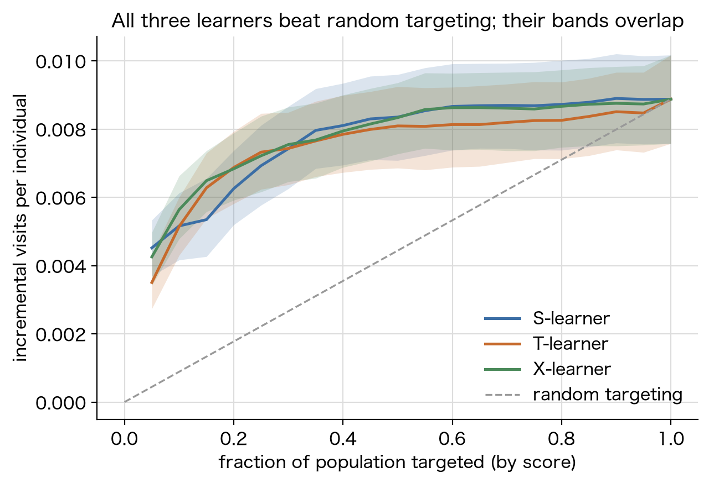

# uplift-modeling-benchmark

English version: [README.md](./README.md)

Criteo のアップリフトデータセットで S/T/X メタラーナーを正直に比較するベンチマーク。全指標にブートストラップ信頼区間を付け、実データの前に合成データで評価基盤そのものを数値検証し、データから言えないことは言えないと明記する。



アップリフトモデリングが答える問いは「誰がコンバートするか」ではなく「誰に広告を出すと行動が変わるか」で、個人ごとの処置効果を推定して、広告が実際に効く人だけを狙う。このプロジェクトでは S・T・X の 3 つのメタラーナーを自前実装し（causalml・scikit-uplift は不使用）、真の効果が既知の合成データで評価基盤全体を検証してから、Criteo のランダム化広告実験 100 万行でベンチマークする。報告するすべての数値にブートストラップ信頼区間を付け、学習器間の比較は共有リサンプルによる対応差の CI で行い、区間で差が付かないペアについては勝者を宣言せずその旨を書く。

## ノートブック

| # | ノートブック | 内容 |
|---|---|---|
| 01 | [合成データによる検証](notebooks/01_synthetic_validation.ipynb) | 既知の処置効果を埋め込み、3 学習器がホールドアウトで真の ATE を回復すること（最大誤差 0.003、許容 0.005）、オラクル順位付けが Qini でランダムに勝つこと、ランダムスコアがほぼ 0 になることを assert で確認する |
| 02 | [Criteo ベンチマーク](notebooks/02_criteo_benchmark.ipynb) | 1,390 万行の実験の EDA、シード固定の層化 100 万行サブサンプル、Qini・AUUC・uplift@10% の 95% ブートストラップ CI 付き S/T/X 比較、対応差 CI、信頼帯付き Qini 曲線と decile 較正 |

コミット済みの実行結果の要点: 3 学習器すべてがランダムターゲティングに勝ち（Qini の CI がいずれも 0 を含まない）、かつどの学習器も他に勝たない（Qini・AUUC・uplift@10% の対応差 CI は 9 ペア中 0 ペアしか 0 を除外しない）。点推定は X-learner が最も高いが、このテストセットでは学習器に順位を付けられない。ノートブックはノイズの上に勝者を立てず、その旨をそのまま書いている。

## この「正直さ」の中身

- ノートブック 01 は測定器の較正にあたる。真の効果が行単位で分かる生成器に対して指標と学習器を走らせ、確認は目視ではなく assert 文で行う。埋めた効果を回復できない基盤で実データを評価しても意味がないため。
- 実データの指標にはすべて群内層化・シード固定のパーセンタイルブートストラップ CI を付ける。学習器の比較は同一リサンプル上の対応差で行い、周辺 CI の重なりから差を主張することはしない。
- Limitations 節に「やっていないこと」を明記する: 分割は 1 回、サブサンプルは 1 つ、基底モデルは 1 構成、特徴量は匿名化済み、アウトカムは利益ではなく visit という代理変数。

## クイックスタート

Python 3.11。

```
python -m venv .venv
source .venv/bin/activate
pip install -r requirements.txt
python scripts/download_data.py
jupyter lab
```

ノートブック 01 はダウンロード不要で約 20 秒で走る。ノートブック 02 は Criteo の生データ（約 311 MB、通常の回線で数分）が必要で、取得後の実行時間は約 2 分。ファイルが無い場合は計算セルをメッセージ付きでスキップする（CI でもこの経路で動く）。

## データとライセンス

| データセット | 取得元 | ライセンス | このリポジトリへのコミット |
|---|---|---|---|
| Criteo Uplift Prediction Dataset v2.1 | Hugging Face Hub `criteo/criteo-uplift`（Criteo AI Lab 公式アカウント） | Criteo による研究目的の公開。データセットカード上は CC BY-NC-SA 4.0 | なし。ダウンロードスクリプト経由のみ |
| 合成データ生成器 | `uplift_bench.synthetic.generate` | - | 実行時に生成 |

補足:

- [Criteo AI Lab のページ](https://ailab.criteo.com/criteo-uplift-prediction-dataset/)からリンクされている歴史的 URL `go.criteo.net/criteo-research-uplift-v2.1.csv.gz` は本プロジェクト作成時点（2026-07）で 404 だったため、`scripts/download_data.py` は公式 Hugging Face ミラーを第一取得先とし、歴史的 URL をフォールバックとして残している。
- データは再配布不可として扱う。`data/raw/` は .gitignore 対象で、実データの行はノートブック出力を含めてリポジトリのどこにもコミットしていない（出力に含まれるのは公開データセットの要約統計のみ）。
- データセットを使う場合の引用先: Diemert, Betlei, Renaudin, Amini, "A Large Scale Benchmark for Uplift Modeling" (AdKDD 2018)。

## リポジトリ構成

```
notebooks/            実行済みノートブック（出力込みでコミット）
notebooks_src/        同内容の jupytext py:percent ソース
src/uplift_bench/     学習器・指標・合成データ生成器・データ処理・作図
tests/                pytest 一式（手計算値との突合を含む）
scripts/download_data.py
assets/               上部の代表図
```

## Limitations

- 訓練/テスト分割は 1 回、サブサンプルは 1 つ。ブートストラップが定量化するのはテストセットの標本ノイズであり、分割間の変動ではない。
- 12 個の特徴量は匿名化されており、特徴量レベルの解釈や業務ルールの抽出はできない。
- `visit` は代理アウトカムで、visit 向けに最適化したモデルがコンバージョンや利益を最大化するとは限らない。コスト・収益の情報はデータに含まれない。
- ITT（intent-to-treat）のみ。`exposure` はランダム化の後に決まる事象のため、処置指標としては意図的に使っていない。
- 基底モデルは 1 構成（正則化したヒストグラム勾配ブースティング）のみ。希少アウトカム向けに選び合成データで検証したが、基底モデルが変われば学習器の順位も変わりうる。

## ライセンス

コードは MIT ライセンス（[LICENSE](./LICENSE)）。Criteo データセットには上表のとおり固有の条件があり、リポジトリには含まれない。
